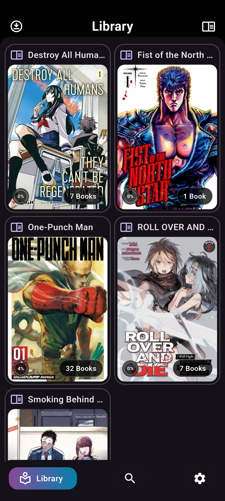

# Kurage (クラゲ)

*Pronounced similarly to “koo-rah-geh” — Japanese for jellyfish.*

> **AI Disclosure:** Kurage is developed with significant AI assistance. I lead the project's UI design and architecture, with AI assisting in investigation and implementation. I've reviewed and tested all changes.

Kurage is a manga and comic reader for [Jellyfin](https://jellyfin.org/), built with Flutter. It focuses on a clean interface, smooth reading, and a fast, responsive experience.

## Features

- CBZ-only support, with unsupported formats filtered from the UI.

- Seamless online and offline operation without separate interfaces.

- Reading progress tracking.

- Stream volumes directly from Jellyfin or download them for offline reading.

- Cover caching and preloading to minimize image pop-in during navigation.

## Screenshots

  
  
   
  
  

## Platform Support
I've only tested Android so far, but iOS should work too.
Windows, macOS, and Linux are untested.

## Credits

Kurage is a fork of [**JellyBook**](https://github.com/JellyBookOrg/JellyBook). Full credit goes to Kara Wilson and the contributors to their project for creating the foundation for Kurage.
